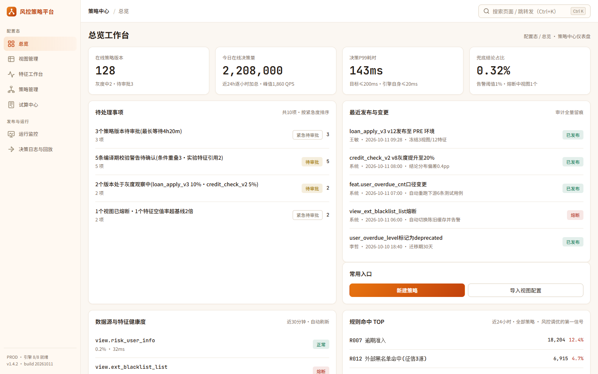
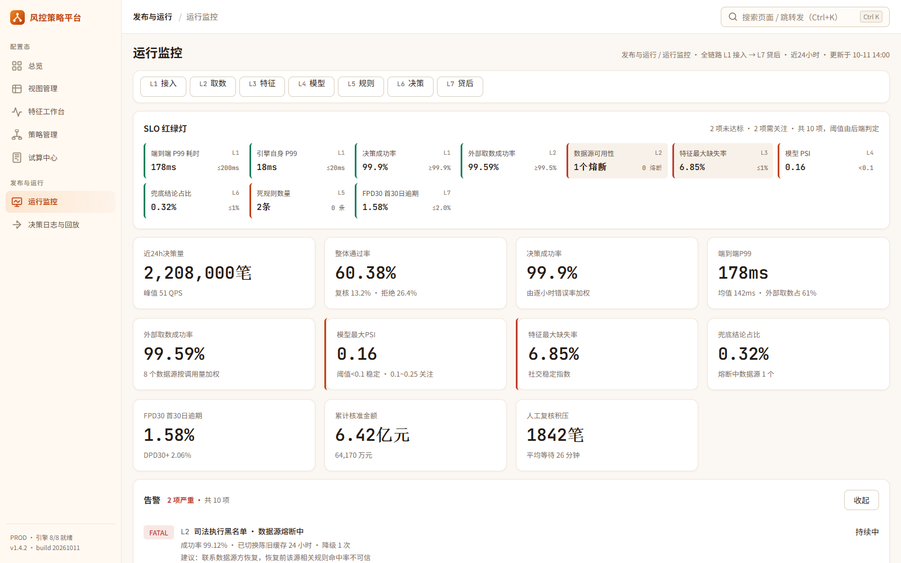
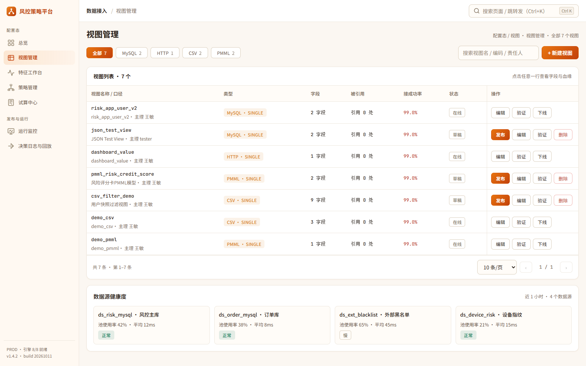
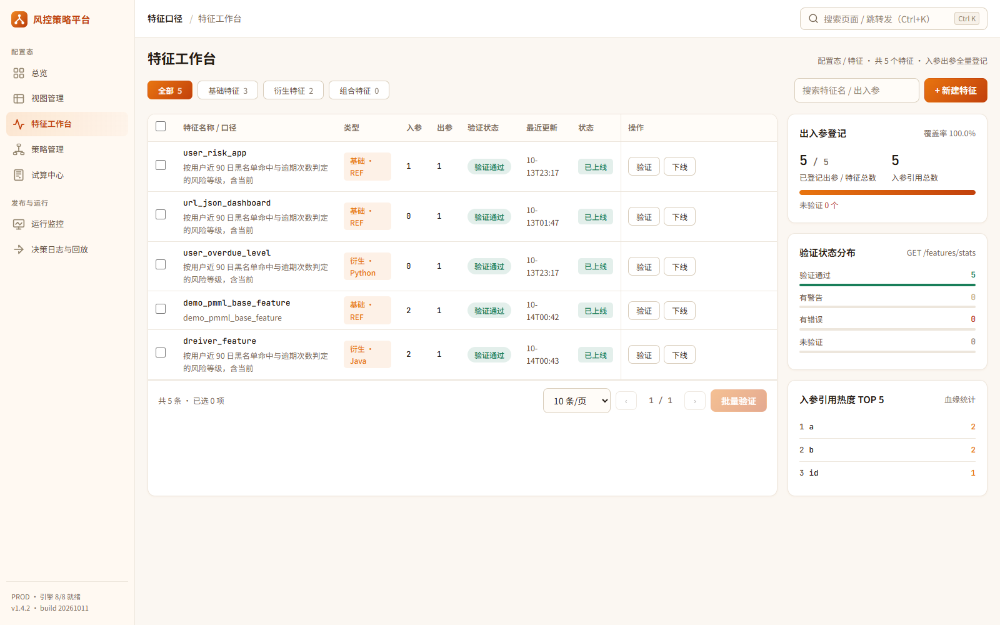
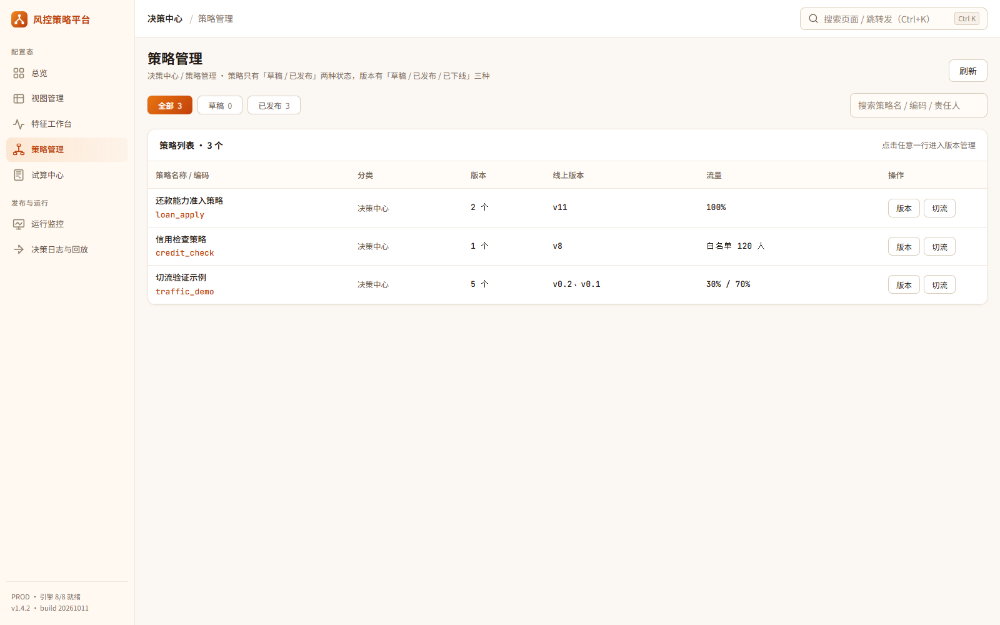
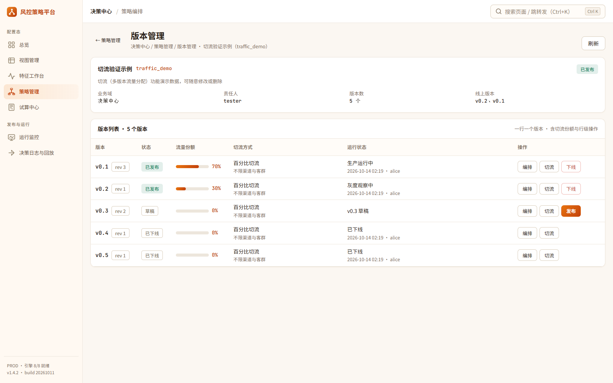
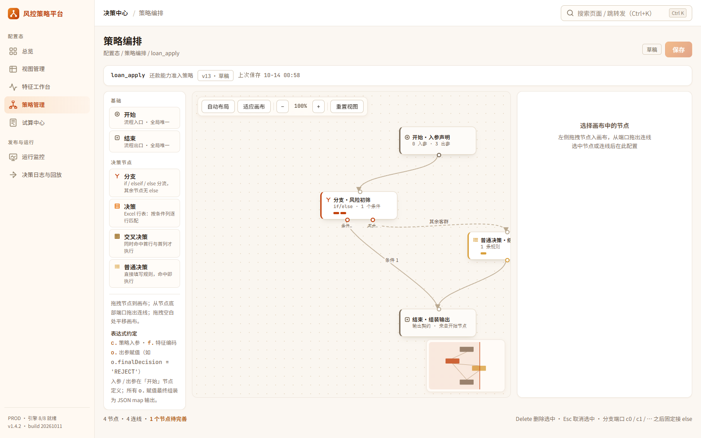
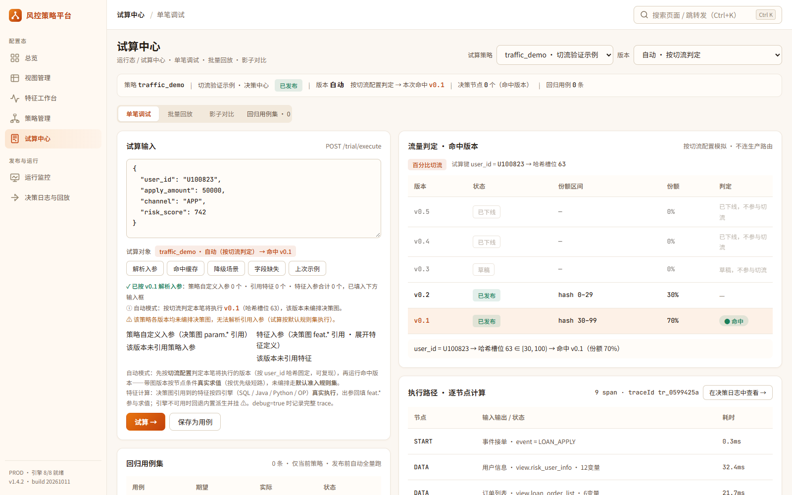

# 风控策略配置平台（Risk Strategy Platform）

把「取数 → 加工 → 决策」三层解耦、全程配置化的风控策略平台：业务在界面上一站式完成
**视图接入、特征加工、策略编排、切流灰度、单笔试算、监控回放**，不写代码即可上线策略。

- **视图（View）**：MySQL / CSV / HTTP / PMML 数据源，脚本 + `$入参` 自动解析出入参
- **特征（Feature）**：基础特征（1:1 映射）+ 衍生特征，支持 **SQL / Java / Python / 算子** 四引擎真实执行，`@@` 引用其他特征/视图
- **决策（Strategy）**：画布拖拽编排（开始 / 分支 / 决策 / 决策树 / 交叉树 / 结束），多版本管理 + 决策级按比例切流
- **试算与回放**：单笔调试走完整流量路由判定，逐节点耗时与变量快照全留痕，可按 traceId 一键回放

## 界面预览

| 总览工作台 | 运行监控 |
|---|---|
|  |  |
| 在线版本 / 今日决策量 / P99 / 兜底占比，待办、最近发布、健康度、规则命中 TOP | P99 趋势、熔断降级、结论分布、规则命中 TOP3 |
| **视图管理** | **特征工作台** |
|  |  |
| MySQL / CSV / HTTP / PMML 视图，字段清单、血缘、降级链、取数预览 | 基础 / 衍生特征清单，SQL / Java / Python / 算子四引擎，输入变量与缺失策略 |
| **策略管理** | **版本管理（独立页）** |
|  |  |
| 策略列表、线上版本、流量占比，入口直达版本管理与编排 | 版本表格页：状态 / 流量 / 节点数，发布、切流、已下线版本复活 |
| **策略编排** | **试算中心** |
|  |  |
| 深色画布拖拽编排，节点属性面板，入参 / 出参契约定义 | 流量判定命中版本（哈希分桶）、逐节点执行路径、耗时与 traceId |

> 截图取自本地演示数据（`database/demo-traffic-switch.sql` 提供 70/30 切流演示策略）。

## 功能模块

| 模块 | 路由 | 说明 |
|---|---|---|
| 总览 | `/dashboard` | 在线策略版本、今日决策量、P99、兜底占比四指标；待办、最近发布与变更、健康度、规则命中 TOP |
| 视图管理 | `/views` | 列表 / 新建 / 编辑 / 验证；MySQL、CSV（上传内嵌）、HTTP、PMML；字段清单、影响面血缘、降级链、取数预览 |
| 特征工作台 | `/features` | 基础特征（映射视图字段）与衍生特征（SQL / Java / Python / 算子）；输入变量、缺失策略、默认值、测试用例 |
| 策略管理 | `/strategy` | 策略列表、线上版本与流量占比；进入版本管理与画布编排 |
| 版本管理 | `/strategy/:id/versions` | 版本表格：状态 / 流量 / 节点数；发布、决策级切流、回滚、已下线版本复活 |
| 策略编排 | `/strategy/:id/editor` | 深色画布：开始 / 分支 / 决策 / 决策树 / 交叉决策树 / 结束节点，拖拽连线，入参出参契约 |
| 交叉决策树 | `/cross-tree` | 维度定义 + 决策矩阵切片查看 |
| 试算中心 | `/trial` | 按策略 + 版本试算；自动判定流量命中版本；逐节点耗时、变量快照、traceId；回归用例 |
| 运行监控 | `/monitoring` | 指标卡、P99 趋势、健康度、熔断降级、结论分布、规则命中 TOP3 |
| 决策日志与回放 | `/track` | 每次调用全量留痕：逐节点耗时、变量快照、命中路径；按 traceId / 结论 / 版本检索，一键回放对比 |

## 技术栈

| 层 | 技术 |
|---|---|
| 前端 | React 18.3 + Vite 5.4 + React Router 6 + ECharts 5.5 + Axios |
| 后端 | Java 21 + Spring Boot 3.3.5 + MyBatis-Plus 3.5.17 |
| 规则引擎 | Calcite（SQL 衍生特征）、Janino（Java 衍生特征）、Python 独立执行服务、OP 算子树求值 |
| 数据库 | MySQL 8（utf8mb4 / InnoDB） |
| Python 执行服务 | Python + FastAPI，进程池隔离执行用户脚本（端口 8090） |

## 目录结构

```
ictriskplatfrom/
├── database/
│   ├── init.sql                  # 建库建表 + 种子数据
│   └── demo-traffic-switch.sql   # 切流演示策略（幂等，可重复执行）
├── backend/                      # Spring Boot 后端（Maven）
│   └── src/main/
│       ├── java/com/riskstrategy/
│       │   ├── controller/       # REST 接口
│       │   ├── service/          # 业务逻辑（含流量路由 / 四引擎接线）
│       │   ├── mapper/           # MyBatis-Plus Mapper 接口
│       │   ├── entity/           # 实体（@TableName / @TableId 注解）
│       │   ├── dto/              # 聚合视图 DTO
│       │   ├── engine/           # SQL / Java / OP 执行引擎适配
│       │   ├── common/           # 统一响应 + 全局异常
│       │   └── config/           # 跨域等配置
│       └── resources/
│           ├── application.yml
│           └── mapper/           # SQL 的 XML 映射文件
├── python-runner/                # Python 衍生特征执行服务（FastAPI + 进程池）
├── frontend/                     # React 前端（Vite）
│   └── src/
│       ├── pages/                # 功能页面
│       ├── layout/               # 侧边导航 + 顶栏 + 快捷搜索
│       ├── components/           # 指标卡 / 徽章 / 图表 / 弹窗
│       ├── api/                  # Axios 封装
│       └── styles/design.css     # 设计系统样式
└── docs/                         # 设计文档（见下方文档索引）
```

## Docker 一键部署

前置：安装 Docker（含 Compose v2）。全部编排与构建文件聚合在 `docker/` 目录：

```
docker/
├── docker-compose.yml        # 四服务编排：mysql / python-runner / backend / frontend
├── backend.Dockerfile        # 后端多阶段构建（Maven+JDK21 → JRE）
├── frontend.Dockerfile       # 前端 Vite 构建 + Nginx 托管
├── python-runner.Dockerfile  # Python 衍生特征执行服务
├── nginx.conf                # 前端站点 + /api 反向代理配置
├── maven-settings.xml        # Maven 阿里云镜像（加速构建）
└── .env.example              # 端口 / 口令等可覆盖变量
```

一键启动：

```powershell
cd docker
Copy-Item .env.example .env    # 可选：自定义端口、MySQL 口令、JVM 参数
docker compose up -d --build
```

启动完成后浏览器打开 <http://localhost>（端口可在 `.env` 的 `FRONTEND_PORT` 修改）。

说明：

- 首次启动会自动初始化数据库（`init.sql` → 监控全链路迁移 → 切流演示数据），仅在数据卷为空时执行一次。
- 服务拓扑：`frontend(nginx:80)` → `/api` 反代 → `backend(8080)` → `mysql(3306)`；`python-runner(8090)` 仅内网访问。
- 后端配置通过环境变量注入，无需改动 `application.yml`。

常用命令（均在 `docker/` 目录下执行）：

```powershell
docker compose ps                  # 查看服务状态
docker compose logs -f backend     # 跟踪后端日志
docker compose up -d --build       # 重新构建并启动
docker compose down                # 停止并移除容器
docker compose down -v             # 停止并删除数据卷（重置数据库）
```

## 快速开始

### 0. 环境要求

JDK 21+、Maven 3.8+、Node.js 18+、MySQL 8。

### 1. 初始化数据库

```bash
mysql -uroot -p < database/init.sql
```

如密码非 `root`，请同步修改 `backend/src/main/resources/application.yml` 的
`spring.datasource.username / password`。

（可选）导入切流演示数据，用于体验 70/30 分流、草稿发布、下线版本复活：

```bash
mysql -uroot -p < database/demo-traffic-switch.sql
```

### 2. 启动后端（端口 8080）

```bash
cd backend
mvn spring-boot:run
```

### 3. 启动 Python 执行服务（端口 8090，可选）

仅当需要真实执行 **Python 衍生特征** 时启动；未启动时后端会按四引擎约定回退（内置原生实现并挂 `Δ` 标记）。

```bash
pip install -r python-runner/requirements.txt
python python-runner/runner.py
```

Windows / Linux 亦可直接运行 `python-runner/start-windows.bat` / `start-linux.sh`。

### 4. 启动前端（端口 5173）

```bash
cd frontend
npm install
npm run dev
```

打开 http://localhost:5173 即可（开发服务器已将 `/api` 代理到 8080）。

生产构建：`npm run build`，产物在 `frontend/dist/`。

## 文档索引

| 文档 | 内容 |
|---|---|
| [01-总体架构与领域模型](docs/01-architecture.md) | 背景目标、能力全景、核心领域模型、设计原则 |
| [02-视图模块设计](docs/02-view.md) | 数据源接入、脚本解析、字段与血缘 |
| [03-特征模块设计](docs/03-feature.md) | 基础 / 衍生特征、输入变量、缺失策略 |
| [04-决策模块设计](docs/04-decision.md) | 决策图、节点类型、版本与切流 |
| [05-执行引擎设计](docs/05-engine.md) | 执行链路、Trace、回放 |
| [06-数据模型与 API 设计](docs/06-data-model-api.md) | 表结构与接口契约 |
| [07-非功能设计与演进规划](docs/07-nfr-roadmap.md) | 性能、可用性、演进路线 |
| [08-前后端接口对齐检查报告](docs/08-api-alignment-audit.md) | 对齐审计与差异说明 |
| [09-基础特征 / 衍生特征](docs/09-feature-base-derived.md) | `@@` 引用与验证入参自动解析 |
| [10-衍生特征执行引擎](docs/10-feature-engines.md) | SQL / Java / Python / OP 四引擎实现说明 |
| [切流（决策级多版本分流）](docs/strategy-traffic-switch.md) | 按比例分流设计与判定规则 |
| [版本管理独立页](docs/strategy-version-manage.md) | 版本表格页交互与接口 |
| [试算中心 · 按策略试算](docs/trial-strategy-select.md) | 策略选择与解析入参 |
| [试算中心 · 流量路由](docs/trial-traffic-route.md) | 自动判定命中版本的执行链路 |

## 说明

- 统一响应格式：`{ "code": 0, "message": "ok", "data": ... }`（非 0 为业务失败）。
- 仓库内置数据均为演示样例；`application.yml` 中的数据库口令为本地开发默认值，部署时请自行修改。
- 后端必须从 `backend/` 目录启动（文件上传等路径以启动目录为基准）。
