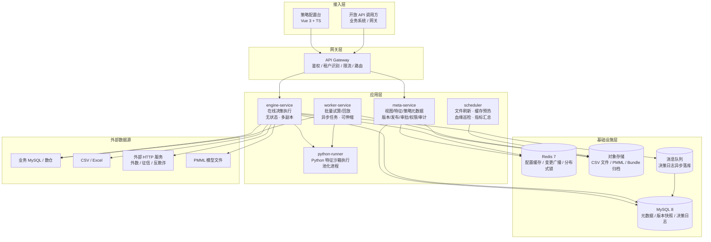
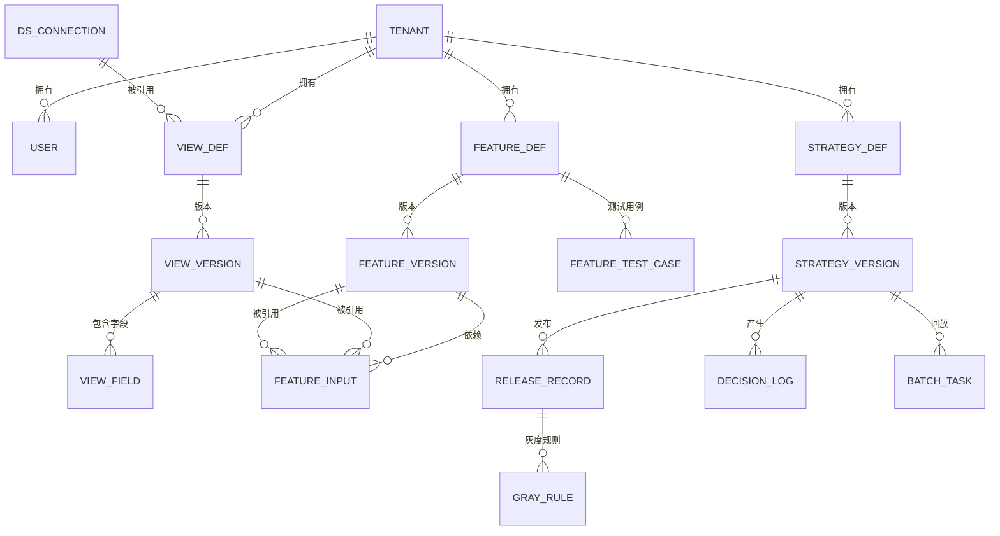
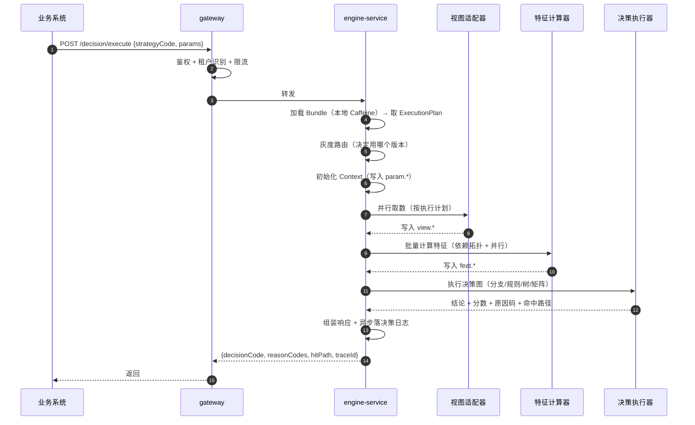

# 01 总体架构与领域模型

## 1. 背景与目标

### 1.1 业务背景

风控策略的生命周期是：**发现问题 → 调整策略 → 验证策略 → 上线策略 → 观察效果**。传统实现下这个循环被研发排期卡住，通常是"周级"，而黑产攻击的变种速度是"天级"。

平台的目标是把循环压缩到**小时级甚至分钟级**，且全程留痕可回滚。

### 1.2 设计目标

| 目标 | 衡量标准 |
|---|---|
| 配置化 | 视图/特征/决策三层全部可视化配置，业务人员可独立完成一次策略变更 |
| 零发版交付 | 策略变更生效不需要重启服务、不需要发版，秒级热加载 |
| 可验证 | 单笔试算、批量回放、影子双跑三种验证手段齐备，上线前可量化对比新旧差异 |
| 可追溯 | 每一次决策都能回答"用了哪个策略版本、哪些特征值、走了哪条路径、为什么是这个结论" |
| 可回滚 | 任意历史版本 30 秒内切回，无需人工介入 |
| 高性能 | 引擎自身开销 ≤ 20ms，整体 P99 ≤ 200ms（含外部取数，见 §7.1 性能预算） |
| 多租户 | 单集群服务多租户，配置/数据/缓存/日志四层隔离，无交叉泄漏 |

### 1.3 明确的非目标（P0/P1 不做）

- ❌ 模型**训练**平台（只做 PMML 模型**托管与执行**，训练在上游完成）
- ❌ 完整 Feature Store（不做特征回填、Point-in-Time 一致性保证，P2 再评估）
- ❌ 实时流式特征计算（P2）
- ❌ 数据治理/数仓建模（视图是"取数通道"，不是数仓）
- ❌ 前端低代码平台（只做本领域专用编排器）

## 2. 能力全景

平台由三个能力域 + 一个横切运行时构成：

```
┌──────────────────────────────────────────────────────────────────────┐
│                          配置态（Control Plane）                     │
│                                                                      │
│  ┌────────────┐      ┌────────────┐      ┌─────────────────────┐    │
│  │  视图模块  │─────▶│  特征模块  │─────▶│      决策模块       │    │
│  │  View      │ 字段 │  Feature   │ 变量 │  Strategy Workflow  │    │
│  │            │      │            │      │                     │    │
│  │ · MySQL    │      │ · 基础特征 │      │ · 分支 / 决策节点   │    │
│  │ · CSV 文件 │      │   (1:1 映射)│     │ · 决策树节点        │    │
│  │ · HTTP     │      │ · 衍生特征 │      │ · 交叉决策树节点    │    │
│  │ · PMML     │      │  SQL/Java/ │      │ · 动作 / 子策略     │    │
│  │ · (Redis/  │      │  Python/算子│     │ · 输出定义          │    │
│  │   ES/Hive) │      │            │      │                     │    │
│  └────────────┘      └────────────┘      └─────────────────────┘    │
│         │                   │                      │                │
│         └───────────────────┴──────────────────────┘                │
│                             │                                        │
│                    ┌────────▼────────┐                               │
│                    │ 版本 / 发布 / 灰度 │                              │
│                    │  审批 / 审计      │                              │
│                    └────────┬────────┘                               │
└─────────────────────────────┼────────────────────────────────────────┘
                              │ Bundle 快照（不可变）
┌─────────────────────────────▼────────────────────────────────────────┐
│                          执行态（Data Plane）                        │
│                                                                      │
│   ┌──────────────┐   变量池    ┌──────────────┐   结果   ┌─────────┐ │
│   │  取数执行器  │──────────▶│  特征计算器  │────────▶│决策执行器│ │
│   │ View Adapter │  view.*    │  SQL/Java/   │ feat.* │ 规则/树 │ │
│   │              │            │  Python/算子 │        │ /矩阵   │ │
│   └──────────────┘            └──────────────┘        └─────────┘ │
│           │                          │                     │       │
│           └──────────────┬───────────┴─────────────────────┘       │
│                          ▼                                          │
│              ┌───────────────────────┐                             │
│              │  统一变量池 Context    │  ← 唯一的数据交换契约        │
│              │  param/view/feat/var/  │                             │
│              │  node/sys              │                             │
│              └───────────────────────┘                             │
└──────────────────────────────────────────────────────────────────────┘
```

**核心思想：变量池是唯一的模块间契约。** 决策层只认 `feat.xxx`，不关心它是基础特征还是 Python 算出来的；特征层只认 `view.X.field`，不关心它来自 MySQL 还是 HTTP。任何一层替换实现，其他层零改动。

## 3. 总体架构

### 3.1 分层架构图



### 3.2 服务划分与职责

| 服务 | 职责 | 形态 | 伸缩维度 |
|---|---|---|---|
| `gateway` | 认证鉴权、租户识别、限流配额、路由 | 无状态 | 请求量 |
| `console-web` | 配置台前端（静态资源） | 静态 | CDN |
| `meta-service` | 视图/特征/策略的 CRUD、图校验、版本快照、发布灰度、审批、RBAC、审计、血缘分析、试算编排 | 有状态（依赖 DB），单体模块化分包 | 垂直 + 只读副本 |
| `engine-service` | 加载 Bundle、编译执行计划、在线决策执行、Trace 上报 | 无状态 | 水平，按 QPS |
| `worker-service` | 批量试算、批量回放、报告生成、离线特征计算 | 无状态，任务消费 | 按任务积压 |
| `python-runner` | Python 特征脚本沙箱执行、依赖包管理 | 无状态，进程池 | 按 Python 特征调用量 |
| `scheduler` | CSV 文件定时刷新、缓存预热、血缘关系巡检、指标汇总、日志归档 | 单实例（选主） | 不伸缩 |

> **为什么 meta-service 不拆微服务**：配置台是低频读写场景（日活操作者几十人），拆分会带来分布式事务、跨服务图校验、版本一致性等一堆问题而收益极小。采用**单体 + 模块化分包**（`view` / `feature` / `strategy` / `release` / `rbac` / `audit` 六个包，包间通过接口通信，禁止跨包直接访问 Mapper），未来要拆时按包切即可。

### 3.3 技术选型

| 层次 | 选型 | 说明 |
|---|---|---|
| 语言/框架 | Java 17 + Spring Boot 3.x | LTS + 虚拟线程可用（JDK21 可升级） |
| Web | Spring MVC（配置台） / 引擎侧轻量 HTTP | 配置台 IO 密集用 MVC 足够 |
| ORM | MyBatis-Plus | 多租户拦截器、逻辑删除开箱可用 |
| 表达式引擎 | **AviatorScript 5.x** | 轻量、AST 可校验、性能优于 SpEL、沙箱友好、支持自定义函数注册 |
| SQL 解析/执行 | **Apache Calcite** | SQL 特征的类型推导、语法校验、内存执行（Enumerable 引擎） |
| Java 沙箱 | **Janino** + 自定义 ClassLoader | 编译快（ms 级）、无字节码依赖、配合 Javaparser 做 AST 黑名单 |
| Python 沙箱 | 独立 CPython 进程池 + REST | 见 03-特征模块 §3.3 |
| PMML | **JPMML-Evaluator** | JVM 生态事实标准，性能好，无外部依赖 |
| 本地缓存 | Caffeine | Bundle 缓存、字段缓存、字典缓存 |
| 分布式缓存 | Redis 7 | L2 缓存、Pub/Sub 变更广播、分布式锁 |
| 连接池 | HikariCP | 按数据源隔离池 |
| 数据库 | MySQL 8.0（utf8mb4） | 元数据 + 版本 + 日志 |
| 对象存储 | MinIO（私有化）/ S3 兼容（SaaS） | CSV、PMML、Bundle 归档 |
| 消息队列 | RocketMQ / Kafka | 决策日志异步落库（可选，量大再上） |
| 前端框架 | Vue 3 + TypeScript + Vite + Pinia | |
| 前端 UI | Element Plus（或 Ant Design Vue） | |
| 流程画布 | **AntV X6**（备选 LogicFlow） | 节点高度可定制，DAG 布局插件成熟 |
| 代码编辑器 | CodeMirror 6 | SQL / Java / Python 编辑器，需自定义补全变量名 |
| 表格编辑器 | 自研（基于 ag-grid 或 el-table 封装） | 决策规则表、交叉矩阵需要 Excel 粘贴 |
| 定时任务 | XXL-Job（SaaS）/ Spring Scheduler（单机） | |
| 可观测 | Micrometer + Prometheus + Grafana + OpenTelemetry | |
| 部署 | Docker + Kubernetes（SaaS）/ docker-compose（私有化） | |

## 4. 核心领域模型

### 4.1 实体关系图



### 4.2 核心实体说明

| 实体 | 说明 | 关键点 |
|---|---|---|
| `Tenant` | 租户（SaaS 客户/内部业务线） | 配额、状态、独立加密密钥 |
| `DsConnection` | 数据源连接 | 连接串密文存储，按租户隔离连接池 |
| `ViewDef` / `ViewVersion` | 视图定义与版本 | 定义=身份（code 不变），版本=内容快照 |
| `ViewField` | 视图字段 | 类型 + 语义类型 + 敏感级别 |
| `DictDef` / `DictItem` | 字典 | 枚举字段的取值域，交叉树分箱复用 |
| `BinDef` | 分箱组件（P1） | 可被多个交叉决策树引用的分箱定义 |
| `FeatureDef` / `FeatureVersion` | 特征定义与版本 | `type=BASE/DERIVED`，`lang=SQL/JAVA/PYTHON/OP` |
| `FeatureInput` | 特征依赖边 | 血缘基础数据 |
| `FeatureTestCase` | 特征测试用例 | 发布前必跑 |
| `StrategyDef` / `StrategyVersion` | 策略与版本 | 版本含 `graph_json` 全量图快照 |
| `ReleaseRecord` | 发布记录 | 版本、环境、灰度规则、操作人、审批链 |
| `GrayRule` | 灰度规则 | 百分比/白名单/渠道/标签 |
| `DecisionLog` | 决策日志 | 可回放的完整现场（采样） |
| `BatchTask` | 批量试算/回放任务 | 输入样本 → 输出明细 + 统计报告 |
| `DepRef` | **统一血缘边** | `(fromType, fromId, toType, toId)`，支撑影响面分析 |
| `AuditLog` | 操作审计 | before/after 全量留痕 |

### 4.3 三层模型的对象映射

理解平台的关键是理解**同一条数据在三个模块里的三种身份**：

```
数据库表 risk_user_info
  └─ 视图 risk_user_info_view  ── 暴露字段 ──┐
                                             │ mobile, age, overdue_cnt
                                             ▼
             基础特征 user_mobile          ── 1:1 引用 ──┘
             基础特征 user_overdue_cnt     ── 1:1 引用 ──┘
                                             │
                                             ▼
             衍生特征 user_overdue_level   ── SQL 加工 ──┐
                                                          │ input: user_overdue_cnt
                                                          ▼
                                              CASE WHEN user_overdue_cnt >= 3 THEN 'H' ...
                                                          │
                                                          ▼
     策略 strategy_loan_apply
        └─ decision 节点 "逾期准入"
             条件: feat.user_overdue_level == 'H'
             结论: REJECT / 原因码 RISK_OVERDUE_HIGH
```

- **视图**回答：数据在哪、怎么取、有哪些列
- **特征**回答：这个值的业务口径是什么、怎么算出来
- **决策**回答：什么条件下输出什么结论

## 5. 核心设计原则

> 这六条原则贯穿全部设计，评审时若发现文档某处违背了它们，那处就是 bug。

### 原则一：配置即数据，版本即快照

所有配置存 DB，不存在"配置在代码里"的情况。**发布动作产生不可变快照（Bundle）**，运行时永远只读快照。回滚 = 把指针切到旧快照。

```
草稿（可随意改） ──发布──▶ Bundle v3（不可变） ──▶ 引擎加载
                              Bundle v2（不可变） ← 回滚切回这里
```

为什么不用"引用最新版本"模式：如果策略 A 引用"特征 X 的最新版"，那么别人改特征 X 会悄无声息改变线上策略 A 的行为。这是生产事故的经典来源。**Bundle 把所有依赖冻结在发布那一刻。**

### 原则二：运行时只读，配置变更发送新版本

引擎不感知"修改"，只感知"加载新版本"。变更广播只传版本号，不传内容（内容按需拉取），保证幂等和一致性。

### 原则三：变量池是唯一契约

跨模块不传对象，只通过变量池的命名空间读写。带来三个好处：模块可独立演进、调试时可 dump 全量中间态、离线回放可精确复现。

### 原则四：一切皆可试算

任何一个视图、特征、策略，在**保存之前**都必须能试算。试算不是"调试辅助功能"，是**保存的必要条件**——这从根本上杜绝了配置错误上线。

### 原则五：在线离线同源

同一份配置定义，由两个执行器（在线引擎 / 离线 Worker）执行，保证语义一致。跨执行器的不一致（浮点、空值、时区、字典版本）在平台层统一规范，而不是靠人小心。

### 原则六：失败必须显式定义

视图超时怎么办？特征算不出来怎么办？矩阵格子没配怎么办？**平台强制要求显式配置降级行为**，不提供"默认继续跑"这种隐含语义。风控场景下，沉默的失败比报错更危险。

## 6. 多租户设计

### 6.1 隔离级别

采用 **共享库共享表 + 行级隔离**（成本最优），在四个层面做隔离：

| 层面 | 隔离手段 |
|---|---|
| 元数据 | 所有业务表带 `tenant_id`，MyBatis 拦截器自动注入条件，唯一索引均含 `tenant_id` 前缀 |
| 数据源 | `DsConnection` 按租户隔离，连接池按 `tenant+dsId` 维度管理，禁止跨租户复用连接 |
| 缓存 | 缓存 key 统一规范 `t:{tenantId}:{type}:{bizId}:{version}`，物理隔离 |
| 对象存储 | 路径前缀 `/{tenantId}/...`，签名 URL 下发 |
| 引擎运行时 | Bundle 缓存 key 含 tenantId；变量池与执行计划不跨租户共享 |

### 6.2 租户上下文传递

```
HTTP Header: X-Tenant-Id  (由网关基于 JWT 解析后注入，业务服务信任网关)
       │
       ▼
TenantContextHolder (ThreadLocal)  ──▶ MyBatis 拦截器（自动拼 tenant_id）
       │                           ──▶ Redis Key 前缀
       │                           ──▶ OSS 路径前缀
       ▼
   异步线程需显式传递（TransmittableThreadLocal，禁止裸用 ThreadLocal）
```

**风险点**：线程池 + ThreadLocal 是租户串号的经典来源。对策：统一封装 `TenantAwareExecutor`，所有异步提交必须走这个包装器；单测层面做"跨租户并发"用例，CI 必跑。

### 6.3 租户级配额

| 配额项 | 说明 | 超限行为 |
|---|---|---|
| 视图数 / 特征数 / 策略数 | 资源数量 | 拒绝创建 + 提示 |
| 在线决策 QPS | 按租户限流（令牌桶） | 429 + 告警 |
| 并发试算任务数 | Worker 并发 | 排队 |
| 单次回放样本量 | 防大任务拖垮集群 | 拒绝 + 提示 |
| 决策日志留存天数 | 存储成本 | 到期归档/清理 |
| 脚本执行资源 | CPU 时间 / 内存 | 超时中断 |

### 6.4 租户级加密

连接串、AK/SK 等敏感配置使用 **AES-256-GCM**，密钥由 KMS 按租户派生（`masterKey + tenantId → tenantKey`）。租户注销时销毁 tenantKey，实现"数据不可恢复"的合规承诺。

## 7. 关键流程串讲

### 7.1 配置态：一次策略变更的完整旅程

```mermaid
sequenceDiagram
    autonumber
    participant U as 风控人员
    participant C as 配置台
    participant M as meta-service
    participant DB as MySQL
    participant A as 审批人
    participant E as engine-service

    U->>C: 编辑策略（新增 decision 节点，引用衍生特征）
    C->>M: 保存草稿
    M->>M: 图校验（环/可达性/变量支配/类型）
    M-->>C: 校验结果 + 错误定位
    U->>C: 点击试算（输入样本）
    C->>M: POST /strategies/{id}/trial
    M->>M: 编译临时 Plan 并执行
    M-->>C: 逐节点 trace + 结论 + 对比旧版本
    U->>C: 提交审批
    M->>DB: 落审批单
    A->>C: 审批通过
    U->>C: 发布（灰度 10%）
    M->>M: 构建 Bundle（冻结策略图+特征版本+视图版本）
    M->>DB: 写入 strategy_version（不可变）
    M->>E: Redis Pub/Sub 广播 config:changed
    E->>E: 异步构建 ExecutionPlan，成功后原子替换
    E-->>M: ACK 就绪
    M->>DB: 更新灰度状态，发布完成
```



### 7.2 执行态：一次决策请求



## 8. 模块依赖规则（防腐化）

| 允许 | 禁止 |
|---|---|
| 决策模块引用特征模块（通过 featureCode） | 决策模块直接引用视图字段（必须经特征）※ 例外见 04 章 §4.5 |
| 特征模块引用视图模块（通过 viewCode.fieldCode） | 视图模块反向引用特征（视图不知道谁在用自己） |
| 全部模块引用 `common`（变量池、表达式、类型系统、错误码） | `common` 反向依赖任何业务模块 |
| meta-service 与 engine-service 共享 `common` + `bundle-sdk` | engine-service 直接写 DB 业务表（只读日志类列外） |
| 编译期校验依赖方向 | 运行期反射绕过校验 |

包结构建议：

```
risk-platform/
├── rp-common/              变量池、类型系统、表达式、错误码、租户上下文
├── rp-bundle-sdk/          Bundle 定义、序列化、签名、版本模型（meta 与 engine 共享）
├── rp-meta-service/        配置态服务
│   ├── view/               视图模块
│   ├── feature/            特征模块
│   ├── strategy/           决策模块
│   ├── release/            版本发布与灰度
│   ├── rbac/               权限
│   └── audit/              审计
├── rp-engine-service/      执行态引擎
│   ├── compile/            编译期：图校验 → 执行计划
│   ├── runtime/            运行期：调度器 + 节点执行器
│   ├── adapter/            视图适配器 SPI 及实现
│   ├── feature/            特征计算器（SQL/Java/算子）
│   └── trace/              Trace 与指标
├── rp-worker-service/      批量回放与离线计算
├── rp-python-runner/       Python 沙箱（独立进程，非 JVM）
└── rp-console-web/         前端配置台
```

## 9. 本章待确认项

- [ ] §3.2 meta-service 单体化是否接受？如果团队规模大、需要前后端独立发布，可以拆 `view-service` / `feature-service` / `strategy-service`，但版本一致性成本会显著上升。
- [ ] §6.3 租户配额的具体数值需要业务给口径。
- [ ] §7.2 是否需要"决策前置校验接口"（业务先问平台"这笔能不能进决策"）？暂未设计。
