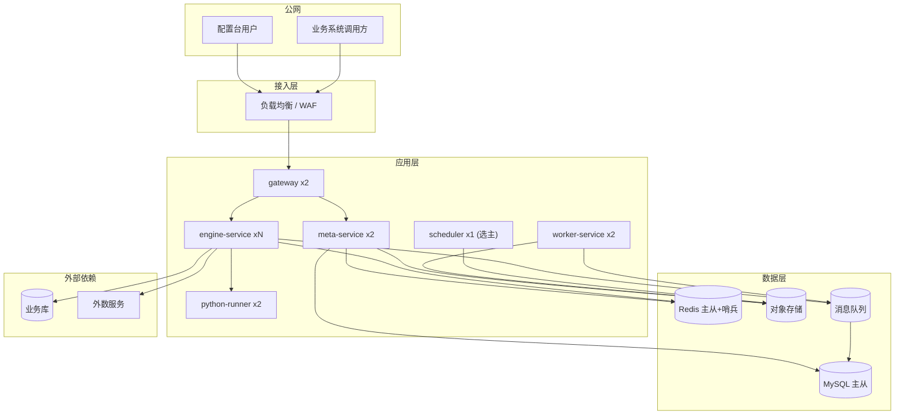

# 07 非功能设计与演进规划

## 1. 性能与容量

### 1.1 性能目标

| 指标 | 目标 | 测量点 |
|---|---|---|
| 在线决策 P99 | ≤ 200ms（含外部取数） | 引擎入口 |
| 在线决策 P50 | ≤ 60ms | 引擎入口 |
| 引擎自身开销 P99 | ≤ 20ms（不含取数） | 内部埋点 |
| 配置保存校验 | ≤ 2s | 含图校验 + 脚本编译 + 血缘分析 |
| 单笔试算 | ≤ 3s | 含真实取数（未命中缓存时） |
| 批量回放吞吐 | ≥ 500 笔/秒/Worker 实例 | 简单策略 |
| 配置热加载生效 | ≤ 10s（99% 实例） | 发布到全部实例就绪 |
| 平台可用性 | 99.95%（年停机 ≤ 4.4h） | 引擎侧 |
| 配置台可用性 | 99.9% | |

> **说明**：99.95% 的可用性要求意味着引擎任何单点故障都不能导致整体不可用。配置台可以低一档（99.9%），因为配置台挂了不影响线上决策。

### 1.2 容量规划（待业务确认具体量级）

| 资源 | 估算方式 | 备注 |
|---|---|---|
| 引擎实例数 | `峰值QPS / 单实例容量 × 1.5`，单实例按 1000 QPS 规划 | 需要压测修正 |
| 引擎规格 | 4C8G 起（JVM 堆 4G） | 视 Bundle 数量与文件视图规模调整 |
| meta-service | 2 实例（4C8G） | 配置台低频，冗余即可 |
| worker-service | 2~4 实例（8C16G） | 回放任务 CPU 密集 |
| python-runner | 2 实例（4C8G），进程池 4~8 | 按 Python 特征调用量 |
| MySQL | 8C32G 主从，SSD | 元数据量小，决策日志是主要压力 |
| Redis | 4C8G 主从 + 哨兵 | 缓存与广播 |
| 对象存储 | 按文件与归档量 | |

### 1.3 数据库压力控制

| 压力源 | 对策 |
|---|---|
| 决策日志写入 | 异步批量（每批 500 条 / 200ms）+ 按月分表 + MQ 削峰 |
| 决策日志查询 | 只查近 7 天热数据；历史走归档表 / 对象存储 |
| 规则命中统计 | **预聚合**（定时任务从日志聚合到 `metric_rule_hit`），不实时 group by |
| Bundle 读取 | Redis 缓存 + 引擎本地缓存，DB 只在缓存未命中时读 |
| 元数据写入 | 低频（配置台操作），天然压力小 |

## 2. 可用性设计

### 2.1 故障域与对策

| 故障 | 影响 | 对策 |
|---|---|---|
| 引擎实例挂掉 | 部分请求失败 | 多副本 + 负载均衡自动摘除；无状态可快速拉起 |
| MySQL 主库故障 | 配置台不可用；**引擎应继续可用** | 引擎的 Plan 全部在本地/Redis 缓存，DB 故障不影响在线决策（**关键设计：引擎不依赖 DB 完成一次决策**） |
| Redis 故障 | L2 缓存失效、配置变更无法广播 | 引擎降级为"仅本地缓存"模式继续服务；配置发布暂停 |
| 某数据源故障 | 依赖它的策略取数失败 | 熔断 + 降级链 + 兜底结论 |
| 外数提供商故障 | 同上 | 熔断 + 陈旧缓存 + 默认值 |
| python-runner 故障 | Python 特征不可用 | 降级（errorPolicy），不影响其他特征 |
| 对象存储故障 | CSV 视图刷新失败、文件上传失败 | 使用已有内存索引继续服务（不重新加载） |
| 配置错误发布 | 线上决策错误 | 图校验 + 试算 + 审批 + 灰度 + 一键回滚 + 兜底结论 |

### 2.2 引擎的"DB 无关"设计（重要）

**引擎在稳态运行时不依赖 DB 和 Redis 完成一次决策。** 这带来三个好处：

1. DB 维护窗口不影响线上决策
2. 引擎的可用性只需达到自身进程的可用性（99.99%+），不受下游存储拖累
3. 冷启动后的第一个请求走同步加载，之后全部走本地缓存

```
引擎启动 ──▶ 从 DB 加载所有"应激活" Bundle（预热）──▶ 编译 Plan ──▶ 本地缓存
                                                                    │
后续请求 ────────────────────────────────────────────────────────────┘
（只读本地缓存；只有配置变更时才重新加载）
```

### 2.3 降级链（按顺序尝试）

```
① 正常执行
   │ 失败
   ▼
② 使用陈旧缓存（stale-while-error，视图级配置，默认允许 1 小时）
   │ 无缓存
   ▼
③ 使用字段/特征默认值 + 记录原因码
   │ 强依赖（配置为 ABORT）
   ▼
④ 中断决策，返回预定义兜底结论（如 REVIEW / REJECT）
   │ 引擎整体不可用
   ▼
⑤ 调用方侧兜底（业务系统自己决定：转人工 / 直接拒绝 / 放行）
```

> **第 ⑤ 层必须在接入文档里明确写给调用方**：平台不承诺 100% 可用，调用方必须有"决策服务不可用时的处理策略"。风控场景通常选择"不可用时转人工"，而不是"不可用时放行"。

### 2.4 SLO 与告警

| SLO | 阈值 | 告警级别 |
|---|---|---|
| 决策成功率 | < 99.9% | P1 |
| 决策 P99 耗时 | > 200ms 持续 5min | P1 |
| 兜底结论占比 | > 1% | P1（说明有系统性问题） |
| 降级率（任一类） | > 5% | P2 |
| 熔断打开 | 立即 | P1 |
| 配置发布失败 | 立即 | P1 |
| 实例版本不一致 | 持续 > 5min | P2 |
| 特征空值率突增 | 超过基线 2 倍 | P2 |
| 规则命中率突变 | 单规则命中率变化 > 50% | P2（策略效果异常信号） |
| 磁盘 / 连接池 / 线程池队列 | 超 80% | P2 |

## 3. 安全与合规

### 3.1 认证与授权

| 层 | 机制 |
|---|---|
| 用户认证 | 用户名密码（BCrypt）/ 企业 SSO（OIDC、LDAP）；SaaS 可选 MFA |
| 会话 | JWT（短期 access token + refresh token），支持强制下线 |
| 授权模型 | RBAC（角色）+ 数据权限（业务域范围）+ 资源权限（单个资源授权） |
| 分权 | **编辑权与发布权分离**（四眼原则）；灰度调整权独立 |
| 服务认证 | 引擎与管理端之间走内部 mTLS 或内部 token |
| 调用方认证 | AK/SK 签名（外部）+ JWT（内部） |

### 3.2 数据安全

| 项 | 措施 |
|---|---|
| 传输 | 全链路 TLS 1.2+ |
| 存储加密 | 连接串、AK/SK 用 AES-256-GCM 加密，密钥按租户派生（KMS 托管） |
| PII 处理 | 字段级 `sensitivity` 标记；展示/日志/导出三层脱敏；**服务端脱敏，前端拿不到原文** |
| 试算记录 | 试算参数中的 PII 脱敏后存储 |
| 决策日志 | PII 脱敏存储；留存期可配；支持按主体删除（个人信息保护合规） |
| 数据导出 | 导出操作需审批 + 全量审计（P1） |
| 备份 | DB 每日全备 + binlog 增量；对象存储跨区冗余 |
| 隔离验证 | 自动化"跨租户越权"测试用例，CI 必跑 |

### 3.3 脚本安全

见 05 章 §7.1。补充一条**运营层面**的要求：

| 项 | 措施 |
|---|---|
| 脚本上线的审批 | 脚本内容在审批单中**完整展示**（不能只显示"修改了脚本"），审批人需要能看到具体代码 |
| 脚本变更审计 | 脚本的每次变更留完整历史（版本快照已保证） |
| 危险操作告警 | 脚本中出现黑名单 API 时，不仅阻断编译，还**告警到安全负责人**（可能是攻击尝试） |
| 沙箱逃逸演练 | 定期做红队演练：尝试从特征脚本逃逸，验证沙箱有效性 |

### 3.4 合规要点

| 要求 | 对应设计 |
|---|---|
| 决策可解释 | 原因码体系 + 命中路径 + 特征快照，能对每一笔决策给出可读解释 |
| 决策可追溯 | 完整决策日志 + 版本快照 + 审计日志 |
| 模型可追溯 | PMML 模型卡（算法、训练数据、指标、负责人） |
| 变更留痕 | 全量审计（who / when / what / before / after） |
| 个人信息最小化 | 字段级敏感标记 + 按需取数 + 日志脱敏 + 留存期控制 |
| 数据出境 | 如涉及，需要租户级数据驻留配置（P2） |

## 4. 部署架构

### 4.1 部署拓扑（SaaS）



### 4.2 环境划分

| 环境 | 用途 | 数据源 |
|---|---|---|
| DEV | 开发自测 | Mock 数据源 |
| TEST | 联调测试 | 测试库 |
| PRE | 预发（与生产同构） | 生产库只读副本（脱敏） |
| PROD | 生产 | 生产库 |

**PRE 环境的价值**：策略在 PRE 用真实数据形态验证（而不是只用几条样本），是"上线前最后一道防线"。PRE 与 PROD 必须同构（同配置、同规格），否则验证无意义。

### 4.3 私有化部署（备选）

如后期需要私有化交付，提供 `docker-compose` 单机版：所有组件 + MySQL + Redis + MinIO 打包，一条命令拉起。功能对齐但**不承诺高可用**（单点）。规模上限：单实例 QPS ≤ 300、策略数 ≤ 200。

### 4.4 发布与回滚

| 层 | 策略 |
|---|---|
| 引擎/服务 | 滚动发布（maxUnavailable=0）；就绪探针校验 Plan 加载完成 |
| 数据库 | Flyway 管理；**DDL 必须向后兼容**（先加列后用，先双写后切读） |
| 配置（策略） | 平台自身的灰度发布能力（吃自己的狗粮） |
| 回滚 | 服务回滚用镜像版本；策略回滚用平台的一键回滚 |
| 兼容性 | 引擎必须能加载**跨版本 Bundle**（向前兼容至少 2 个大版本），否则回滚后引擎读不懂旧配置 |

> **"引擎要能读旧版 Bundle"这条容易被忽略但极其重要**：如果新引擎不支持旧格式 Bundle，一旦发布新引擎就再也回不去了。

## 5. 迭代规划

### 5.1 P0 —— 全链路最小闭环

**目标**：跑通"配视图 → 配特征 → 配策略 → 试算 → 发布 → 在线决策"完整链路。

| 模块 | 交付内容 |
|---|---|
| 视图 | MySQL（表 + SQL 模式）、CSV 文件、HTTP 三类；字段探测；取数预览；连通性测试；缓存与降级；影响面分析 |
| 特征 | 基础特征（含全部约束校验）；衍生特征 SQL 类型；依赖 DAG；测试用例；特征试算；批量预览 |
| 决策 | 图模型 + START / DATA / FEATURE / BRANCH / DECISION / SCRIPT / ACTION / END；变量池；表达式引擎 + 函数库；**自动依赖注入**；编译期全套校验（含支配性分析） |
| 调试 | 单笔调试（逐节点 trace + 命中高亮 + 变量快照）；试算用例保存与回归 |
| 发布 | 草稿/版本/Bundle 快照；审批（单人模式）；发布；一键回滚；版本 diff |
| 引擎 | 编译期 + 运行期；热加载；缓存；熔断降级；Trace 与指标；决策日志 |
| 平台 | 多租户基础（隔离 + 配额）；RBAC；审计日志；OpenAPI 文档 |
| 前端 | 配置台全部页面；画布；变量选择器；决策规则表（含 Excel 粘贴） |

**P0 验收标准**：
1. 从零开始配置一个"贷前准入"策略（2 视图 + 5 特征 + 分支 + 决策节点），全流程 ≤ 30 分钟完成，无需研发介入
2. 单笔调试能完整展示每个节点的入参、出参、耗时、命中路径
3. 策略发布后 10 秒内在所有引擎实例生效
4. 编译期能拦住至少 15 类配置错误（含变量未支配、边不穷尽、类型不匹配、脚本越权）
5. 压测：P99 ≤ 200ms，错误率 ≤ 0.1%
6. 一键回滚：30 秒内切回历史版本
7. 跨租户越权测试用例全部通过

### 5.2 P1 —— 决策能力补全与生产化

| 模块 | 交付内容 |
|---|---|
| 特征 | Java 特征（Janino 沙箱）；Python 特征（python-runner）；可视化算子库 |
| 视图 | PMML 视图（JPMML）；Redis 视图；视图版本订阅（多视图合并取数优化） |
| 决策 | **决策树节点**；**交叉决策树节点**（矩阵模式 + 双树模式 + 编译成规则集 + 分箱组件）；子策略节点；并行网关；外部调用节点 |
| 前端 | 树可视化编辑器；**矩阵编辑器**（框选填充、Excel 粘贴、undo/redo、diff 高亮、颜色语义） |
| 验证 | 批量回放（含新旧对比报告）；影子模式；阈值扫描（P2 提前） |
| 发布 | 灰度（百分比/白名单/渠道/标签）；自动灰度推进；异常自动回滚；双人审批 |
| 运维 | 规则命中统计；特征健康度（空值率/漂移）；在线离线一致性对账 |
| 集成 | 调用方 SDK（Java）；批量决策接口优化 |

**P1 验收标准**：
1. 交叉决策树：能配置 3 维 × 4 箱的矩阵（48 格），框选批量填充流畅，保存校验能识别分箱重叠/缺失
2. 交叉树执行性能：与同规模规则表对比，耗时不劣于（多级索引生效）
3. 批量回放：10 万笔样本在 10 分钟内完成并产出对比报告
4. 灰度：10% 灰度流量稳定路由，可实时查看两版本的结论分布对比
5. Python/Java 特征沙箱：通过安全测试用例集（含逃逸尝试）

### 5.3 P2 —— 智能化与生态

| 方向 | 内容 |
|---|---|
| 实时特征 | Kafka 流式特征源 + 实时特征计算（Flink 或自研窗口聚合） |
| 特征市场 | 特征检索、推荐、复用统计、跨策略特征共享治理 |
| 模型管理 | 模型注册、A/B 测试、模型效果监控、模型与策略的联合评估 |
| 智能辅助 | 基于历史数据自动推荐阈值/分箱（如"逾期次数分的自然断点在 2 和 5"）；规则有效性分析（哪条规则应该下线） |
| AB 实验 | 策略级 AB 实验框架（分流 + 效果指标 + 显著性检验） |
| 策略模板市场 | 预置行业策略模板（贷前准入、反欺诈、额度定价），租户一键复制 |
| 生态 | 更多数据源类型（Hive/ES/Dubbo/gRPC）；特征平台互通（Feature Store 协议） |
| 多人协作 | 实时协同编辑、评论、变更讨论 |

## 6. 工作量估算（粗略，供排期参考）

> 假设：5 人团队（3 后端 + 2 前端）+ 0.5 测试 + 0.5 产品，单位为人日。

| 模块 | 后端 | 前端 | 说明 |
|---|---|---|---|
| 基础框架（多租户、RBAC、审计、公共组件） | 25 | 6 | |
| 视图模块（3 类适配器 + 校验 + 预览） | 40 | 18 | MySQL/SQL 解析是重点 |
| 特征模块（基础 + SQL 衍生 + 依赖 + 测试） | 35 | 20 | |
| 决策模块（图模型 + 编译校验 + 8 类节点 + 调试） | 50 | 45 | 前端画布是大头 |
| 表达式引擎与函数库 | 15 | 5 | |
| 引擎（编译期 + 运行期 + 缓存 + 熔断 + Trace） | 45 | — | 核心资产 |
| 发布与版本（Bundle + 审批 + 灰度 + diff） | 25 | 15 | |
| 平台与集成（API、日志、指标、部署） | 20 | 5 | |
| 联调 / 压测 / 修 Bug | 30 | 20 | 经验比例 20~25% |
| **P0 合计** | **285** | **134** | ≈ **420 人日 ≈ 4 人 × 5 个月** |
| P1（决策树 + 交叉树 + Java/Python + 回放 + 灰度） | 160 | 90 | ≈ 250 人日 |
| P2 | — | — | 按需规划 |

> **提示**：交叉决策树的矩阵编辑器（前端）和编译优化（后端）在 P1 的占比不小，建议 P1 单独排期，不要和 P0 混在一起估。

## 7. 风险与对策

| 编号 | 风险 | 影响 | 应对 |
|---|---|---|---|
| R1 | **配置错误导致生产事故**（一条错误规则上线，批量拒绝客户） | 极高 | 图校验 + 强制试算 + 审批分离 + 灰度 + 一键回滚 + 兜底结论 + 决策日志可回放。**六道防线缺一不可** |
| R2 | **外数延迟不可控导致决策超时** | 高 | 熔断 + 超时预算 + 降级链 + 与调用方约定兜底策略；对慢外数做专项优化（缓存/异步预热） |
| R3 | **Java 沙箱逃逸** | 高 | AST 白名单 + ClassLoader 隔离 + SecurityManager（如 JDK 版本支持）+ 安全测试 + 红队演练；如风险不可接受，改用独立进程 |
| R4 | **在线离线不一致**（策略试算通过但线上行为不同） | 中高 | 同源定义 + 统一类型/空值/时区规范 + 一致性对账任务 + Bundle 冻结依赖版本 |
| R5 | **交叉矩阵维度爆炸**（业务方配出 5000 格） | 中 | 格子数硬上限 + 覆盖率告警 + 引导拆分策略 + 编译期合并优化 |
| R6 | **多租户数据泄漏** | 极高 | 框架层强制隔离 + 自动化越权测试 + 敏感操作二次校验 + 定期安全审计 |
| R7 | **Python runner 成为瓶颈** | 中 | 限制在线 Python 特征数量 + 池化 + 降级 + 监控；必要时把热点 Python 特征重写为 Java |
| R8 | **特征口径漂移**（上游改口径未通知） | 中高 | 血缘影响面分析 + 空值率/分布监控 + 上游变更自动重跑下游测试用例 + 口径说明强制填写 |
| R9 | **平台自身成为瓶颈**（复杂度高、学习成本大） | 中 | 配置台内置引导（选型建议、错误提示、模板）；分层使用（新手只用算子 + 规则表，进阶用 SQL，专家用 Java） |
| R10 | **引擎版本与 Bundle 格式不兼容导致无法回滚** | 中 | 明确向前兼容要求（≥2 个大版本）；Bundle 带格式版本号；发布前做"旧引擎读新 Bundle"的兼容测试 |
| R11 | **决策日志量超预期** | 中 | 采样开关 + 分级存储（热 7 天 + 归档）+ 字段裁剪 + 大小上限 |
| R12 | **合规要求变更**（数据留存、可解释性） | 中 | 关键数据（原因码、命中路径、版本快照）设计为长期保留；留存期做成配置项而非硬编码 |

## 8. 落地建议（给项目的三条建议）

1. **先做纵向切片，再做横向铺开**。不要先把"视图模块做完再做特征模块"——应该先打通"1 个 MySQL 视图 + 1 个基础特征 + 1 个决策节点 + 在线决策"这条最窄的链路，跑通了再扩适配器、扩节点类型。这样能在第 2 周就发现架构问题，而不是第 3 个月。

2. **交叉决策树不要一开始做**。它是产品差异化价值，但依赖图模型、编译框架、规则集执行三块地基。P0 先把这三块做扎实（用分支 + 决策节点验证），P1 做交叉树时会发现工作量比预期小很多。

3. **把"试算 + 回放 + 灰度 + 回滚"当作 P0 的一等功能，不要当作运维工具**。风控平台的价值不在"能配策略"，而在"配错了不会出事"。这四件事决定了业务方敢不敢用这个平台。

## 9. 本章待确认项

- [ ] §1.1 性能目标需要业务给出真实口径（峰值 QPS、可接受延迟、可用性要求）。
- [ ] §1.2 容量规划需要根据 R1（实际数据量）修正。
- [ ] §4.2 是否需要 PRE 环境？会增加一套完整部署成本，但对高风险策略变更的价值很大。
- [ ] §4.3 是否有私有化交付需求？如果有，架构上需要额外考虑"无 K8s 环境"的部署与升级方案。
- [ ] §5 迭代规划需要与业务优先级对齐 —— 特别是 P1 中"决策树 / 交叉树 / Python 特征 / 批量回放"四者的先后顺序。
- [ ] §6 工作量估算需要团队自己按熟悉度修正（尤其前端矩阵编辑器与画布）。
- [ ] 未决：**是否需要多机房（异地多活）**？如果需要，Bundle 分发、配置一致性、日志回传需要补充设计。

---

## 附：全套文档的待确认项汇总

请优先确认以下 6 项，它们会影响多个模块的设计：

| 编号 | 问题 | 影响范围 |
|---|---|---|
| Q1 | 峰值 QPS / P99 延迟 / 可用性 的精确目标 | 引擎线程模型、部署规格、压测标准 |
| Q2 | 决策日志：全量还是采样？留存多久？ | 存储成本、回放能力、合规 |
| Q3 | 审批流：平台统一流程 vs 租户自定义 | 是否需要引入工作流引擎（成本差异大） |
| Q4 | 是否需要多机房部署 | 部署架构、一致性设计 |
| Q5 | Java 沙箱风险容忍度（内存限制无法硬性实施） | 是否需要独立进程执行 Java 特征 |
| Q6 | 是否有存量硬编码策略需要迁移导入 | 是否需要额外的迁移工具（工作量不小） |
